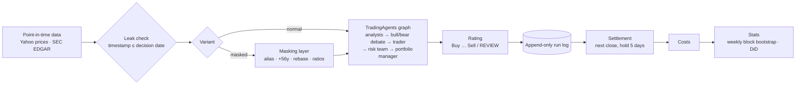

# TradingAgents Stress Test

**Is an LLM multi-agent trading system skilled — or did the model just memorize the answers?**


-lightgrey)

An independent evaluation of the open-source [TradingAgents](https://github.com/TauricResearch/TradingAgents) framework (multi-agent LLM trading on LangGraph). We re-test it under conditions its original paper did not control for: **look-ahead bias from the model's own training data, trading costs, and proper statistics.** "The edge disappears" is a valid outcome.

> Research and learning project by Gavin Li and Aya. **Not financial advice.**

---

## TL;DR

- **Problem.** Published LLM-trading results are usually short backtests on dates the model may have *seen during training*. A model that remembers how 2023 went will look skilled on 2023.
- **Approach.** Use a local model with a known knowledge cutoff (`llama3.1:8b`, Dec 2023), compare dates **inside** vs **after** its training data, and add a **masked** variant that hides the company and the calendar. The memorization gap is a difference-in-differences.
- **Status.** Methodology, masking specification, and pilot runner are done; full experiments are pending. **No performance numbers are reported yet** — see [Results](#results).

---

## Why this matters

TradingAgents is one of the most-starred LLM trading repos, but the evidence behind it is thin:

- The original paper backtests ~3 months (Jan–Mar 2024) on a few large US tech stocks, without slippage.
- An outside check found a buy-and-hold baseline in the paper with the wrong sign (AAPL −5.23% reported vs +9.12% recomputed).
- A follow-up study reports Sharpe falling from 0.43 to 0.22 after costs, with very wide confidence intervals on short windows.
- **Parametric look-ahead bias** — the model "knowing" the future from its training data — is not fixed by filtering the input data.

So the question is not *"can it make money?"* but **"does any edge survive a clean, cost-aware, statistically honest test?"**

## Research questions

| ID | Question | Experiment |
|---|---|---|
| **RQ1** | Does the same model perform better on dates **inside** its training data than **after** its cutoff? | 2×2 memorization test |
| **RQ2** | After trading costs and across seeds, is there a statistically meaningful edge over simple baselines? | Costs + block bootstrap |
| **RQ3** | Is the multi-agent debate worth its extra compute? | Ablation: full / no-debate / single agent |
| **RQ4** | Is the memorization gap larger around earnings announcements? | Event study (side) |

---

## Method

### 1. A model with a known cutoff, run locally

`llama3.1:8b` (knowledge cutoff Dec 2023) served by Ollama on a consumer GPU (8 GB VRAM), pinned by model digest. **2023 is in-sample** (the model may have seen it); **2025 is out-of-sample** (it cannot have). Newer API models are deliberately excluded from evaluation: their training data covers both periods.

### 2. The 2×2 memorization test

|  | **Normal** (real ticker & dates) | **Masked** (`STOCK_A`, shifted calendar) |
|---|---|---|
| **2023 — seen in training** | A | B |
| **2025 — after cutoff** | C | D |

$$
\text{Memorization gap} = (A - B) - (C - D)
$$

Comparing 2023 with 2025 alone confuses memorization with a change in market regime. Masking within each year, then differencing across years, cancels both the regime effect and the information lost by masking.

### 3. Masking layer (spec v1)

| What the agent would see | What it sees when masked |
|---|---|
| `JPM`, "JPMorgan Chase" | `STOCK_A`, "a large-cap US bank" |
| Real dates | Dates shifted **+56 years** — the Gregorian calendar repeats every 28 years, so month, day, weekday and leap days are preserved exactly |
| Prices | Rebased so the decision-date close = 100 |
| Technical indicators | Price-unit indicators rescaled; unitless ones (RSI) unchanged; unknown indicators **fail closed** |
| Financial statements | Ratios only (ROE, ROA, growth rates); all dollar amounts and text fields removed |

Masked outputs are **rebuilt from numbers, not scrubbed from text**, and every agent-visible message is scanned afterwards. A real name in a *tool output* is our leak (run excluded); a real name produced *by the model itself* is logged as an **identity guess** — a direct, secondary measure of memorization. Full spec: [`INSTRUCTIONS.md` §5.2](INSTRUCTIONS.md).

### 4. Honest statistics

- **Point-in-time data only:** financial statements by SEC *filing date*, never period end.
- **Costs:** commission + half-spread per side, with 0 / 5 / 10 bps sensitivity.
- **Baselines:** buy-and-hold, always-BUY, random trades at equal turnover, SMA crossover. Hit rate is compared to the always-BUY base rate, not to 50%.
- **Uncertainty:** block bootstrap **by week** (the banks in one week move together, so decisions are not independent), Sharpe standard errors, multiple seeds.
- **No silent failures:** unparseable or crashed runs are logged with their own status, never counted as HOLD.
- **Pre-registration:** grid and metrics are fixed in the [Decision Log](INSTRUCTIONS.md) before any out-of-sample run.

### Pipeline



Universe: four US money-center banks (`JPM`, `BAC`, `WFC`, `C`), weekly decisions, H1 2023 vs H1 2025, benchmark SPY.

---

## Findings so far (engineering & methodology)

These came up while building the harness, before any performance numbers:

1. **Shared agent memory can leak the future across backtest runs.** TradingAgents keeps a persistent "lessons" file shared by every run by default. Running June before March lets the March decision read June's outcome, and lets masked runs read lessons that name the real company. Every run here gets an isolated, empty memory file.
2. **Silent prompt truncation.** Ollama's default context is 4K tokens; TradingAgents prompts are longer and get cut without an error. We serve an 8K-context model and verified it with a 7,025-token probe through the same OpenAI-compatible endpoint the framework uses.
3. **Pinned to a version with a look-ahead fix.** v0.7.1 fixes a bug where an un-padded date (`2024-7-5`) made SEC EDGAR return filings dated *after* the decision. We pin that release and still run our own independent leak check.
4. **Identity enters before any tool is called.** The graph injects the real company name and date into its initial state, so masking tool outputs alone would not hide identity; the masking layer also intercepts the instrument context.
5. **No seed control upstream.** The framework exposes temperature but not a seed; seeds are set per model in Ollama Modelfiles (`llama3.1-8k-s1`, `-s2`) to make runs reproducible.

---

## Results

**Pending.** Experiments have not been run yet; no performance numbers are reported. When they are, every configuration and seed — including failed runs — will be published in [`results/tables/`](results/tables/), with confidence intervals.

Planned headline table:

| Metric | A: 2023 normal | B: 2023 masked | C: 2025 normal | D: 2025 masked | Gap (A−B)−(C−D), 95% CI |
|---|---|---|---|---|---|
| Hit rate vs always-BUY | — | — | — | — | — |
| 5-day alpha vs SPY | — | — | — | — | — |
| Net Sharpe (after costs) | — | — | — | — | — |
| Identity-guess rate (masked) | n/a | — | n/a | — | — |

---

## 📍 Status

| Done ✅ | Next ⬜ |
|---|---|
| Research design, pre-registration rules, decision log | 6 pilot runs + go/no-go checks (timing, tool-call failure rate, prompt length, seed reproducibility) |
| Local model served with 8K context, verified on GPU | `src/masking.py` per spec v1, then a masked smoke test |
| TradingAgents pinned at v0.7.1 + source audit | Evaluation harness: grid runner, costs, statistics, leak check |
| Masking specification v1 | Experiments 1–4, results tables, write-up |
| Pilot runner (`src/pilot.py`) with tests: isolated memory, append-only log, failures never counted as HOLD | |

Who did what, and when: [`WORKLOG.md`](WORKLOG.md).

---

## Repository

```
README.md               this page
INSTRUCTIONS.md         experiment design, weekly plan, decision log (single source of truth)
AGENTS.md / CLAUDE.md   rules for AI coding agents: research integrity, code conventions, limits
CONTRIBUTING.md         how the two of us branch, commit, review and merge
WORKLOG.md              dated record of who did what
PROJECT_SUMMARY.md      background, references, learning resources
configs/                Ollama Modelfiles (8K context, per-seed), experiment grids
src/pilot.py            pilot runner
src/                    masking, costs, statistics, leak checks, grid runner (in progress)
tests/                  pytest suite (no network, no LLM calls)
results/RUN_INFO.md     pinned versions and hardware for every machine that runs experiments
```

## Quickstart

```powershell
git clone https://github.com/gavin0829afg/tradingagents-stress-test
cd tradingagents-stress-test
py -3.12 -m venv .venv
.\.venv\Scripts\Activate.ps1
pip install -r requirements.lock     # includes TradingAgents pinned at v0.7.1
python -m pytest                     # unit tests, no model needed
```

To run the agent you also need Ollama and the 8K-context model: see [`INSTRUCTIONS.md` §4](INSTRUCTIONS.md).

## How we work

Two people, each with AI coding assistants (Claude for design and review, Codex for implementation). Every change goes through a pull request reviewed by the other person; modules that can silently invalidate results (masking, leak checks, statistics, costs, run logging) also get a dedicated AI review against a written checklist. Commits carry an `AI-assisted:` trailer. Rules for humans: [`CONTRIBUTING.md`](CONTRIBUTING.md); rules for agents: [`AGENTS.md`](AGENTS.md). Internal working docs are bilingual (English / Chinese).

## Team

- **Gavin Li** ([@gavin0829afg](https://github.com/gavin0829afg)) — University of Waterloo, Financial Analysis & Risk Management + Statistics
- **Aya** ([@ayaw888](https://github.com/ayaw888))

## Acknowledgements & license

Built on [TradingAgents](https://github.com/TauricResearch/TradingAgents) by Tauric Research (Apache-2.0), which is installed as a dependency and not redistributed here. Code in this repository is released under the [MIT License](LICENSE). Not financial advice.
